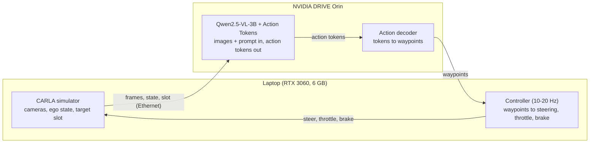
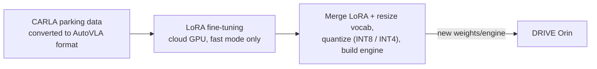

# e2e-vla-parking

An end-to-end vision-language-action (VLA) model for automated parking, adapted from [AutoVLA](https://github.com/ucla-mobility/AutoVLA), fine-tuned on CARLA parking data, and deployed on an NVIDIA DRIVE Orin.

This is a master's project (12 weeks, **23 Nov 2026 to 14 Feb 2027**) by [@AbdelrhmanNouby](https://github.com/AbdelrhmanNouby). It is not affiliated with the AutoVLA authors.

**Status:** in progress (Phase 0 — project kickoff). Code lands phase by phase; the [roadmap](#roadmap) lists all phases and their gates.

## Research question

How much does fine-tuning an AutoVLA-style model on CARLA parking data improve closed-loop parking success, and what does quantized deployment on a DRIVE Orin cost in latency and accuracy?

## Architecture

The Orin runs only the model. A laptop simulates the vehicle in CARLA and runs the low-level controller, while a rented cloud GPU trains the weights.

### Real-time loop



1. CARLA sends multi-camera RGB frames, ego vehicle state, and target slot pose over Ethernet to the Orin inference endpoint.
2. The model (`Qwen2.5-VL-3B` extended with `K` action tokens and `<no_reasoning>`, adapted from AutoVLA) returns `N` action tokens in fast mode.
3. The action decoder maps the tokens through the parking codebook into waypoints: one motion step every `0.5 s` across a `4.0 s` horizon.
4. A controller running at `10-20 Hz` on the laptop tracks the waypoints and sends steering, throttle, and brake back to CARLA asynchronously while the next plan is inferred.

### Offline pipeline



Fine-tuning starts from either the released AutoVLA checkpoint or the `Qwen2.5-VL-3B` base model; the project compares both. Only **fast mode** (direct action tokens, no chain-of-thought) is in scope.

### Where each machine is used

| Machine | Role | Notes |
| --- | --- | --- |
| Laptop (RTX 3060, 6 GB) | CARLA simulator, `10-20 Hz` controller, data conversion, small smoke tests | Meets the 6 GB minimum for CARLA and cannot co-host the VLM |
| NVIDIA DRIVE Orin | Quantized model inference and latency/memory/power profiling | Linked to the laptop via Ethernet |
| Cloud GPU (rented) | Codebook clustering, LoRA fine-tuning, full-precision reference & ablation runs | Rented in focused blocks to manage compute budget |

The inference runtime on the Orin (NVIDIA's DriveOS LLM SDK or TensorRT Edge-LLM) is chosen in Phase 1, depending on the Orin's software stack.

## Model inputs and outputs

The starting values below adapt AutoVLA's setup and are tuned in the ablations.

**Inputs**

| Input | Format | Starting value |
| --- | --- | --- |
| Camera images | RGB views from CARLA: front, rear, left, right | Default: `4 cameras x 2 frames` (now and `-0.5 s`) at `448x448` (~2,000 visual tokens). Lighter fallback for the Orin: `4 x 1` frame at `336x336` (~580 visual tokens) |
| Target slot | Text: `x, y` (m) and `yaw` (deg) in the car's frame, plus slot type | Rounded to `0.1 m` and `1 deg`; type is `perpendicular` or `parallel` |
| Car state | Text: speed, acceleration, steering angle, gear, last two action tokens | Captures vehicle dynamics alongside visual frames |
| Instruction and mode | Fixed system prompt, `"park in the target slot"`, and a mode flag | Fast mode only |

**Outputs**

| Output | Format | Starting value |
| --- | --- | --- |
| Action tokens | Fixed `<no_reasoning>` template, then `N` tokens from `<action_0>` to `<action_{K-1}>`. Each token is one `0.5 s` motion step `(dx, dy, dyaw)` in the car's frame | `N = 8` (`4.0 s` ahead). `K` is picked from `{256, 512, 1024}` by reconstruction error; AutoVLA used `2,048` for open-road driving |
| Waypoints | The tokens decoded through the codebook into `(x, y, yaw)` every `0.5 s` | Reversing appears as negative forward displacement, so there is no separate gear output |
| Vehicle commands | A controller tracks the waypoints: steering from path tracking, throttle and brake from a speed controller | Controller runs at `10-20 Hz` on the latest plan |

Example of a single model call:

```text
Images:  front, rear, left, right x 2 frames
Prompt:  Park in the target slot. Mode: fast.
Slot:    x=6.2 m, y=-2.5 m, yaw=90 deg, type=perpendicular
State:   speed=0.8 m/s, accel=0.1 m/s2, steer=-12 deg, gear=reverse
Output:  <no_reasoning> <action_412> <action_97> ... (8 action tokens)
```

Adding `<no_reasoning>` and `K` action tokens enlarges the vocabulary by `K + 1` entries in the embedding and LM-head layers, so weight merging, quantization, and export to the Orin must preserve the extended vocabulary consistently.

## Data

The project starts from one public CARLA parking dataset and rebuilds the action codebook specifically for parking motions (reversing, tight turns), since AutoVLA's driving codebook does not cover it.

| Dataset | Size | Notes |
| --- | --- | --- |
| [ParkFormer](https://arxiv.org/abs/2506.16856) | 272 episodes, ~46,400 frames at 10 Hz | Perpendicular and parallel layouts, randomized pedestrians |
| [E2E Parking Dataset](https://arxiv.org/abs/2504.10812) | To be checked | Reference result for the original E2E Parking model: 85.16% success, 0.24 m position error, 0.34 deg orientation error |
| [ParkingScenes](https://arxiv.org/abs/2604.22835) | 704 episodes, ~105,000 frames | Release on GitHub announced; availability to be confirmed |

Conversion steps:
1. Store synchronized camera images, car state, target slot pose, and future poses (`+0.5 s` to `+4.0 s`) per frame.
2. Build the action codebook with AutoVLA's clustering script for `K` in `{256, 512, 1024}` and measure reconstruction error.
3. Write AutoVLA-format training JSON, split by episode (`80/10/10`), and hold out one CARLA map.

## Evaluation

| Axis | Metrics |
| --- | --- |
| Closed loop in CARLA | Target success rate, position error (m), orientation error (deg), collision rate, time to park |
| Open loop | ADE and FDE (m and deg) of the decoded path against the expert path; action-token accuracy |
| Orin cost | Time per plan (vision encoder, prefill, decoding), peak memory, power draw, end-to-end loop latency |
| Quantization fidelity | Share of identical action tokens and mean path deviation against full precision (`FP16`/`BF16`) |

Experiments:

| ID | Question | Change |
| --- | --- | --- |
| E1 | Does driving pretraining help parking? | Start from the released AutoVLA checkpoint |
| E2 | Baseline for E1 | Start from `Qwen2.5-VL-3B` base |
| E3 | How large a codebook is needed? | `K = 256, 512, 1024` |
| E4 | How much visual input can the Orin afford? | `4 cameras x 2 frames` at `448x448` against `4 x 1` at `336x336` |
| E5 | What does quantization cost? | `FP16`, `INT8`, and `INT4` on the Orin |
| E6 | How much data is needed? | `25%`, `50%`, and `100%` of training episodes |
| E7 | Does the Orin change closed-loop results? | Same weights: GPU server against Orin engine |

## Roadmap (12 Weeks: 23 Nov 2026 – 14 Feb 2027)

Each phase ends in a go/no-go gate. Weeks run Monday to Sunday starting **23 Nov 2026**.

| Phase | Weeks | Dates | Goal | Gate |
| --- | --- | --- | --- | --- |
| 0 | W1 | 23 Nov to 29 Nov 2026 | Setup and checks | Orin stack recorded, checkpoint runs once, one dataset downloaded, scope approved |
| 1 | W2–W4 | 30 Nov to 20 Dec 2026 | Baseline on the Orin | Released checkpoint runs on the Orin with measured latency and memory, or a fallback is chosen |
| 2 | W3–W5 | 7 Dec to 27 Dec 2026 | Data, codebook, test harness | Dataset loads in AutoVLA's training code, codebook reconstructs well, scripted closed-loop run completes |
| 3 | W6–W8 | 28 Dec 2026 to 17 Jan 2027 | Fine-tuning | Fine-tuned model beats the zero-shot checkpoint on held-out open-loop error; closed-loop success measured |
| 4 | W9–W10 | 18 Jan to 31 Jan 2027 | Deploy the fine-tuned model on the Orin | Model runs on the Orin inside the CARLA loop and completes full episodes |
| 5 | W10–W11 | 25 Jan to 7 Feb 2027 | Evaluation and ablations | All metrics finalized; **numbers frozen on 7 Feb 2027** |
| 6 | W11–W12 | 1 Feb to 14 Feb 2027 | Report and demo | Final thesis/project report, reproducible repo, and demo ready; **final handover on 14 Feb 2027** |

## Repository layout (planned)

The layout will change as code lands.

```text
configs/    training and evaluation configs (AutoVLA configs edited for parking)
tools/      dataset converters and the codebook builder
harness/    closed-loop CARLA runner, 10-20 Hz controller, and policy server
deploy/     export, quantization and Orin engine scripts
docs/       notes, results and figures
data/       converted datasets (not committed)
LICENSE     MIT License
```

## Getting started

Setup instructions will be added as each phase lands. Prerequisites:

- The [AutoVLA](https://github.com/ucla-mobility/AutoVLA) code and its conda environment
- [Qwen2.5-VL-3B-Instruct](https://huggingface.co/Qwen/Qwen2.5-VL-3B-Instruct) and the released [AutoVLA checkpoint](https://huggingface.co/Zewei-Zhou/AutoVLA)
- [CARLA](https://carla.org/), in the version the chosen dataset used
- An NVIDIA DRIVE Orin with its DriveOS or JetPack software stack

## References

- Zhou et al., [AutoVLA: A Vision-Language-Action Model for End-to-End Autonomous Driving with Adaptive Reasoning and Reinforcement Fine-Tuning](https://arxiv.org/abs/2506.13757), NeurIPS 2025
- [NVIDIA DriveOS LLM SDK](https://developer.nvidia.com/blog/streamline-llm-deployment-for-autonomous-vehicle-applications-with-nvidia-driveos-llm-sdk/)
- [NVIDIA TensorRT Edge-LLM](https://nvidia.github.io/TensorRT-Edge-LLM/0.8.0/user_guide/getting_started/supported-models.html)

## License

This project is licensed under the **MIT License** — see the [LICENSE](LICENSE) file for details. Third-party components (AutoVLA, Qwen2.5-VL, CARLA, datasets) keep their own licenses.
